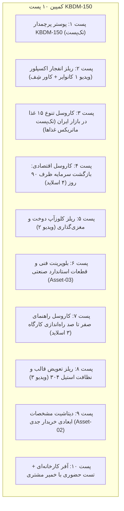

# برنامه اجرایی ۱۰ پست اول کمپین KBDM-150 (نسخه نهایی کاروسل‌محور)

این مستند بر اساس اصلاحیه جدید، پست‌های متنی را به کاروسل‌های چنداسلایدی ورق‌زدنی (با کاور هیرو و اسلایدهای جادار) تبدیل کرده است.

---

## ۱. جدول بسته‌های بصری کمپین (شامل ۲ کاروسل اختصاصی)

| بسته محتوایی | نوع محتوا | تعداد اسلاید | کاور / اسلاید اول | مسیر پوشه اسلایدها |
| :--- | :--- | :--- | :--- | :--- |
| **کاروسل ۱: بازگشت سرمایه و بیزینس‌پلن (ROI)** | کاروسل چنداسلایدی (۴:۵) | ۴ اسلاید | هیرو دستگاه + قلاب ۹۰ روز | [carousel_roi/](file:///D:/Machinedesign.ir/social-content/launch-dumpling-series/02_generated_visuals/carousel_roi/) |
| **کاروسل ۲: راهنمای راه‌اندازی کارگاه** | کاروسل چنداسلایدی (۴:۵) | ۳ اسلاید | هیرو دستگاه + قلاب کارگاه | [carousel_workshop/](file:///D:/Machinedesign.ir/social-content/launch-dumpling-series/02_generated_visuals/carousel_workshop/) |
| **پوستر رسمی پرچمدار** | تک‌پست (۴:۵) | ۱ اسلاید | عکس دستگاه + ۴ مشخصه پایه | [sample_poster_kbdm150_official.jpg](file:///D:/Machinedesign.ir/social-content/launch-dumpling-series/02_generated_visuals/sample_poster_kbdm150_official.jpg) |
| **پوستر سرآشپز و محصولات** | تک‌پست / کاور ریلز (۱:۱) | ۱ اسلاید | شِف + چیدمان پیراشکی و غذاها | [asset_01_chef_lifestyle_hero.jpg](file:///D:/Machinedesign.ir/social-content/launch-dumpling-series/02_generated_visuals/asset_01_chef_lifestyle_hero.jpg) |
| **اینفوگرافیک ابعاد و دیتاشیت** | تک‌پست / کاتالوگ (عمودی) | ۱ اسلاید | جدول کامل و ابعاد سه‌بعدی | [asset_02_full_specs_infographic.jpg](file:///D:/Machinedesign.ir/social-content/launch-dumpling-series/02_generated_visuals/asset_02_full_specs_infographic.jpg) |
| **بلوپرینت قطعات و استاندارد CE** | تک‌پست فنی (عمودی) | ۱ اسلاید | نام قطعات و نشانگرهای فنی | [asset_03_technical_blueprint_callouts.jpg](file:///D:/Machinedesign.ir/social-content/launch-dumpling-series/02_generated_visuals/asset_03_technical_blueprint_callouts.jpg) |
| **ماتریکس ۱۵ محصول ایرانی و ملل** | تک‌پست تنوع (عمودی) | ۱ اسلاید | گرید سمبوسه، کلمپه، پیراشکی... | [asset_04_food_matrix_commercial.jpg](file:///D:/Machinedesign.ir/social-content/launch-dumpling-series/02_generated_visuals/asset_04_food_matrix_commercial.jpg) |
| **ویدیوها و ریلزها** | ریلز ویدیویی | ۳ ویدیو | استخراج از فریم‌های ویدیویی کاربر | `video_01`, `video_02`, `video_03` |

---

## ۲. توزیع ۱۰ پست در تقویم انتشار

