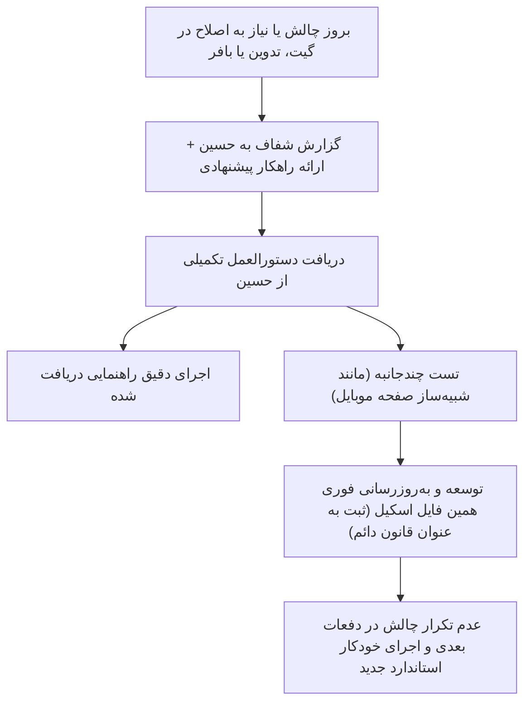

# MachineDesign Social Media Production & Scheduling Master Workflow

این اسکیل، مرجع جامع، همه‌جانبه و یکپارچه برای تمام مراحل چرخه تولید محتوا، تولید ریلزهای ویدیویی مهندسی، تست خوانایی موبایل، کپی‌رایتینگ، طراحی گرافیک، میزبانی دارایی‌ها و زمان‌بندی هوشمند با Buffer برای برند **MachineDesign.ir** و کانال‌های وابسته است.

این نسخه تجمیعی، نکات حیاتی اسکیل‌های تخصصی (`hook-writer`, `caption-writer`, `carousel-writer`, `hashtag-strategy`, `instagram-growth`, `graphic-design-aesthetics`) را مستقیماً در خود ادغام کرده تا نیازی به فراخوانی چند اسکیل همزمان نباشد.

---

## ۱. استراتژی هشتگ ۲۰۲۶ و محدودیت سخت‌گیرانه (Hashtag Protocol)

### ۱.۱. قانون سقف ۵ هشتگ (Hard Cap: Maximum 3 to 5 Hashtags)
* **خط قرمز اینستاگرام:** تعداد هشتگ‌ها در هر پست **هرگز نباید از ۵ عدد بیشتر شود**. ارسال بیش از ۵ هشتگ علاوه بر ریسک بلاک یا عدم انتشار توسط API اینستاگرام، سیگنال اسپم به الگوریتم ارسال کرده و ریچ پست را سرکوب می‌کند.
* **ترکیب بهینه ۳ تا ۵ هشتگی برای ماشین دیزاین:**
  1. **۱ تگ برندینگ اختصاصی:** `#ماشین_دیزاین` یا `#machinedesign`
  2. **۲ تگ دسته‌بندی نیش و صنعتی:** `#ماشین_آلات_صنعتی` یا `#خط_تولید`
  3. **۱ تا ۲ تگ اختصاصی محصول/موضوع:** `#پیراشکی`، `#سمبوسه`، یا `#صنایع_غذایی`

### ۱.۲. سئو محتوایی به جای انباشت هشتگ (Social SEO)
* در الگوریتم مدرن، متن درون تصویر، ۳ ثانیه اول ویدیو، و کلمات کلیدی متن کپشن ۱۰ برابر بیشتر از هشتگ‌ها در سرچ و اکسپلور ایندکس می‌شوند.

---

## ۲. اصول طراحی بصری و مهندسی کاروسل‌ها (Visual & Carousel Architecture)

### ۲.۱. ممنوعیت مطلق تصاویر متراکم متنی
* هرگز اطلاعات سنگین، جداول مقایسه‌ای یا راهنماهای متنی طولانی در یک تک‌پست فشرده نمی‌شوند.
* هرگونه محتوای تحلیلی، مقایسه‌ای یا آموزشی باید حتماً در قالب **کاروسل چنداسلایدی (نسبت ۴:۵ یا ۱۰۸۰×۱۳۵۰)** طراحی شود.

### ۲.۲. آناتومی اسلاید اول (The Cover Hook Slide - برگرفته از hook-writer & carousel-writer)
* **یک وعده واضح و صریح (Promise the Swipe):** اسلاید اول باید دلیلی به کاربر بدهد که انگشتش را برای ورق زدن حرکت دهد.
* **تصویر قهرمان (Hero Machine):** عکس بزرگ، باکیفیت و ترجیحاً کراپ دقیق دستگاه در مرکز یا پایین کادر (ارتفاع حداقل ۵۰٪ تا ۵۵٪ کل بوم).
* **هدر سازمانی:** لوگوی رسمی متالیک MachineDesign.ir + عنوان انگلیسی و فارسی برند + بج اختصاصی مدل دستگاه در گوشه راست (مانند `MODEL: KBDM-150` یا `SLIDE 1/4`).
* **تیتر قلاب (Headline):** فونت بزرگ و بولد **وزیرمتن سیاه (Vazirmatn Black)** با رنگ سرمه‌ای سازمانی (`#0f1c30`) و سطر دوم با رنگ آبی/تیل صنعتی (`#104e5c`).
* **کپسول ورق زدن داینامیک:** دکمه بیضی شکیل با پس‌زمینه تیره و متن سفید (`ورق بزنید ◀`) با مارجین داینامیک (`pw = text_width + 90`).

### ۲.۳. دیسیپلین اسلایدهای میانی (One Idea Per Slide)
* هر اسلاید فقط روی **یک ایده/بخش مشخص** تمرکز دارد.
* حداکثر ۳ یا ۴ کارت خلوت با خط تأکید رنگی، بولت‌پوینت‌های متقارن و پس‌زمینه لایت (`#f8fafc`).
* **پرهیز از شکست نامناسب کلمات:** هرگز متن‌ها بر اساس تعداد کاراکتر هاردکد کات نمی‌شوند؛ خطوط با جمله‌بندی مشخص و معنایی طراحی می‌شوند.

### ۲.۴. اسلاید پایانی و کال‌تواکشن (Conversion & Save CTA)
* اسلاید آخر محل تبدیل است؛ نه تکرار حرف‌های قبل.
* جدول خلاصه یا نتیجه کلیدی (باکس طلایی برای بازگشت سرمایه یا باکس آبی برای پیش‌فاکتور).
* **فراخوان اقدام تک‌کلمه‌ای (Keyword DM Trigger):** مانند «جهت دریافت کاتالوگ و بیزینس‌پلن، کلمه سود/کارگاه را در دایرکت بفرستید».

---

## ۳. پایپ‌لاین تولید ریلز ویدیویی مهندسی (Engineering Video Reels & Motion Pipeline)

تولید ریلزهای صنعتی و نمایش ماشین‌آلات با بالاترین سطح درگیری (Engagement) بر اساس اصول زیر پیاده‌سازی می‌شود:

### ۳.۱. ترکیب فوتیج‌های کارگاهی (Multi-Segment Video Assembly)
* **نسبت تصویر و ابعاد:** عمودی کامل ۹:۱۶ (**۱۰۸۰ × ۱۹۲۰** پیکسل)، با نرخ فریم ۳۰fps و اسکن Progressive.
* **کادربندی مکانیزم‌ها (Zero-Clip):** در مقیاس‌بندی ویدیوهای دستگاه، هرگز نباید عرض تصویر کراپ شود تا قطعات متحرک، کانوایر یا بازوها بیرون نزنند (`scale=1080:1920:force_original_aspect_ratio=decrease,pad=1080:1920:(ow-iw)/2:(oh-ih)/2:black`).
* **طول ایده‌آل ریلز:** بین ۳۵ تا ۴۸ ثانیه برای ریلزهای محصول‌محور (حداکثر انتقال دیتا بدون ریزش توجه کاربر).

### ۳.۲. تولید نریشن صوتی هوش مصنوعی (AI Voiceover via Gemini Flash TTS)
* **مدل:** هوش مصنوعی Gemini Flash TTS با لحن رسمی، موقر و مهندسی.
* **فرمول نگارش متن نریشن:**
  1. *قلاب بحران (۰ تا ۶ ثانیه):* اشاره به هزینه بالای کارگری یا کندی کار دست.
  2. *مزیت مکانیکی (۶ تا ۲۰ ثانیه):* معرفی سیستم نورد، قالب‌ها و عدم خرابی خمیر.
  3. *توجیه اقتصادی (۲۰ تا ۳۲ ثانیه):* نرخ تولید بالا (تا ۱۰,۰۰۰ در ساعت) و بازگشت سرمایه زیر ۹۰ روز.
  4. *کال‌تواکشن نهایی (۳۲ تا ۳۹ ثانیه):* دعوت به ارسال کلمه کلیدی در دایرکت برای استعلام قیمت.

### ۳.۳. موزیک پس‌زمینه صنعتی (YouTube Audio Library)
* **سبک قطعات:** قطعات مدرن، الکترونیک پرانرژی با تم تک و تجاری (Tech & Modern Upbeat Drive) ترجیحاً بدون کپی‌رایت از کتابخانه صوتی یوتیوب (مانند قطعات *Infraction*).
* **آرشیو قطعات:** ذخیره در پوشه محلی `branding/audio/` جهت استفاده مجدد در کمپین‌ها.

### ۳.۴. مهندسی صدا، داگینگ هوشمند و فیدآوت (Audio Ducking & Mixing)
* **ادغام همزمان ۳ استریم صوتی در FFmpeg:**
  1. *صدای آمبیانس کارگاهی دستگاه (`[0:a]`):* ولوم کنترل‌شده روی **۶٪ تا ۸٪** جهت القای حس واقعی و صنعتی محیط کارخانه.
  2. *صدای نریشن گوینده (`[1:a]`):* افزایش ولوم به **۱۳۵٪** با تأخیر ۰.۵ ثانیه‌ای در شروع برای هماهنگی با تصویر.
  3. *موزیک پس‌زمینه (`[2:a]`):* **داگینگ هوشمند (Ducking)** با فرمول شرطی:
     - ولوم در ثانیه اول: **۳۵٪**
     - ولوم حین صحبت گوینده (ثانیه ۰.۵ تا ۳۹.۵): کاهش اتوماتیک به **۱۰٪** جهت شفافیت کامل کلمات
     - ولوم پس از اتمام نریشن (روی کارت پایانی): اوج‌گیری مجدد به **۴۰٪**
     - فیدآوت صوتی: فیدآوت نرم و تدریجی ۱.۵ تا ۲ ثانیه‌ای در انتهای ویدیو (`afade=t=out:st=44.8:d=1.7`).
* **یکسان‌سازی سمپل‌ریت:** تمامی استریم‌ها باید با `aresample=48000` به سمپل‌ریت یکپارچه ۴۸ کیلوهرتز استریو تبدیل شوند تا از ناهماهنگی یا قطعی صدا جلوگیری گردد.

### ۳.۵. قانون تطبیق قطعی نریشن با ویدیو دستگاه (No Early Outro Rule)
* **خط قرمز تدوین ریلز:** نریشن گوینده باید **۱۰۰٪ تا آخرین کلمه روی تصویر ویدیوی متحرک دستگاه** پخش شود.
* **نمایش مستقل کارت پایانی:** کارت پایانی (اطلاعات تماس، دکمه CTA و شماره تلفن) صرفاً و منحصراً **پس از اتمام کامل نریشن** روی صفحه ظاهر می‌شود و برای مدت ۵ تا ۶ ثانیه باقی می‌ماند تا کاربر فرصت کافی برای خواندن شماره تلفن و اسکرین‌شات گرفتن داشته باشد.

---

## ۴. استاندارد تست و شبیه‌سازی خوانایی روی صفحه موبایل (Mobile Viewport Readability Standard)

ویدیوهای عمودی ۱۰۸۰×۱۹۲۰ هنگام مشاهده در گوشی‌های هوشمند معمولی (عرض نمای ۳۹۰ تا ۴۱۲ پیکسل مانند سری گلکسی سامسونگ یا آیفون)، با ضریب **۰.۳۶** کوچک می‌شوند. متنی که در ادیتور دسکتاپ واضح است، در موبایل کاملاً ناخوانا خواهد شد مگر اینکه قواعد زیر رعایت شود:

### ۴.۱. حداقل اندازه و ضخامت تایپوگرافی در ویدیوها و اورلی‌ها:

| المان بصری | حداقل اندازه فونت در ۱۰۸۰p | نوع و وزن فونت | رنگ و کنتراست الزامی |
| :--- | :--- | :--- | :--- |
| **تیتر اصلی فارسی (کارت زیرنویس)** | **۵۴ تا ۶۰ پوینت** | `Vazirmatn-Black` | سفید خالص (`#ffffff`) با تراز راست |
| **زیرعنوان و توضیحات فنی** | **۳۶ تا ۴۲ پوینت** | `Vazirmatn-Bold` | سفید درخشان یا نئون روشن (پرهیز از طوسی کدر) |
| **بج متغیر و کدهای لاتین (HUD)** | **۲۴ تا ۳۰ پوینت** | `Orbitron Bold` | سبز نئون (`#8ce70c`) درون کپسول شیشه‌ای با حاشیه |
| **هدر بالای صفحه (برند و مدل)** | **۳۰ تا ۳۲ پوینت** | `Orbitron Bold` | سفید + سبز نئون با بج LIVE |
| **کپسول‌های مشخصات فنی (پایان)** | **۳۴ تا ۳۸ پوینت** | `Vazirmatn-Bold` | سفید خالص با آیکون دایره نئون |
| **دکمه فراخوان به اقدام (CTA)** | **۴۶ تا ۵۰ پوینت** | `Vazirmatn-Black` | فونت تیره پررنگ روی باکس نئون سبز کامل |
| **شماره تماس مستقیم** | **۴۸ تا ۵۴ پوینت** | `Vazirmatn-Black` | سبز نئون پررنگ و درشت: `۰۹۳۵ ۸۶۸ ۹۸۲۹` |

### ۴.۲. نواحی امن رابط کاربری اینستاگرام (Instagram Reels Safe Zones)
* **ناحیه امن بالا:** هدر ویدیو باید در محدوده `y = 110` تا `220` قرار گیرد (فاصله از نوار استاتوس و هدر اینستاگرام).
* **ناحیه امن پایین:** کارت‌های محتوایی و زیرنویس باید در بازه `y = 1330` تا `1670` قرار گیرند. محدوده زیر ۱۶۸۰ محل قرارگیری کپشن، نام پیج و ایکون صدای اینستاگرام است.
* **ناحیه امن راست:** از قرار دادن متن در ۱۵۰ پیکسل سمت راست در نیمه پایینی تصویر خودداری شود (محل دکمه‌های لایک، کامنت، اشتراک و ذخیره).

### ۴.۳. فرآیند تست شبیه‌سازی قبل از انتشار:
پیش از هرگونه انتشار ریلز، اسکریپت شبیه‌ساز باید فریم‌های کلیدی را با ابعاد **۳۹۰×۶۹۳ پیکسل** استخراج کرده و خوانایی آن‌ها در کمتر از ۱ ثانیه بررسی و تأیید شود.

---

## ۵. اطلاعات تماس رسمی و هویت‌های سازمانی (Verified Brand Identities)

* **نام مالک و کارشناس ارشد:** مهندس **حسین وطن‌دوست** (Hossein Vatandoust)
* **شماره تلفن همراه و تجاری رسمی:** **`09358689829`** (`۰۹۳۵ ۸۶۸ ۹۸۲۹` / `+98 935 868 9829`)
  - *خط قرمز مطلق:* هرگز و تحت هیچ شرایطی نباید از شماره تلفن‌های ساختگی یا فرضی (dummy) در ویدیوها، کاتالوگ‌ها، پوسترها یا کپشن‌ها استفاده شود.
* **پیج بیزینسی رسمی اینستاگرام:** **`@machinedesign.ir`** (شناسه بافر: `6adb4d84778b240e2f9c776b`)
* **پیج شخصی و همکار (Collaborator):** **`@h.vatan.doust`** (شناسه بافر: `6adbbe89778b240e2fa2e674`)
* **وب‌سایت رسمی:** `machinedesign.ir`
* **کانال‌های تلگرام و بله:** `@machinedesign_ir`

---

## ۶. فرمول کپی‌رایتینگ و کپشن‌نویسی (Caption & Copywriting Formula - برگرفته از caption-writer)

هر کپشن برای پیج بیزینسی و شخصی ماشین دیزاین بر اساس فرمول ۴ مرحله‌ای زیر نگاشته می‌شود:
1. **خط اول (قلاب اسکرول - The Scroll-Stopper):**
   - کوتاه، چالش‌برانگیز یا برانگیزاننده کنجکاوی صنعتی (مانند: *چرا این دستگاه ظرف کمتر از ۹۰ روز پول خودش را برمی‌گرداند؟* یا *هنوز سمبوسه و پیراشکی رو دستی و با چنگال می‌پیچید؟! 🤔🥟*).
2. **ارزش فنی و اعداد ملموس (The Meat & Proof):**
   - بدون کلی‌گویی و با اعداد دقیق مهندسی: ظرفیت ۱۰,۰۰۰ عدد در ساعت، استیل ۳۰۴، ۵ قالب تعویض‌پذیر، ۱ سال گارانتی رسمی + ۱۰ سال تامین قطعات.
3. **اعتباردهی و مشارکت (Co-author & Direct Dial):**
   - منشن پیج شخصی: `👨‍🔧 نظارت فنی و مشاوره: @h.vatan.doust`
   - شماره تماس معتبر: `📞 تماس مستقیم: ۰۹۳۵۸۶۸۹۸۲۹`
4. **فراخوان به اقدام صریح (Single Clear CTA):**
   - فقط یک کلمه کلیدی مشخص: «جهت استعلام قیمت روز و دریافت ویدیوهای عملکردی دستگاه در کارخانه، کلمه «پیراشکی» را در دایرکت بفرستید.»
5. **بخش پایانی:** حداکثر ۳ تا ۵ هشتگ هدفمند و نیچ در انتهای کپشن.

---

## ۷. پایپ‌لاین آپلود و CDN گیت‌هاب (Asset Hosting Pipeline)

سرویس Buffer تصاویر و ویدیوها را از وب دانلود می‌کند؛ بنابراین لینک‌ها باید کاملاً مستقیم (`raw.githubusercontent.com`) باشند.

### ۷.۱. مخزن رسمی دارایی‌ها:
* **مخزن:** `https://github.com/GreatFooliao111/machinedesign-social-assets`
* **شاخه اصلی:** `main`
* **مسیر دارایی‌ها:**
  - ویدیوها و ریلزها: `campaigns/<campaign_name>/03_video_reels/`
  - پوسترهای گرافیکی و کاروسل‌ها: `campaigns/<campaign_name>/02_generated_visuals/`
  - صداها و موزیک‌ها: `branding/audio/`
  - لوگوها و تایپوگرافی: `branding/logos/`

### ۷.۲. فرآیند آپلود خودکار:
```bash
git -C "D:\Machinedesign.ir\machinedesign-social-assets" add .
git -C "D:\Machinedesign.ir\machinedesign-social-assets" commit -m "Update social assets"
git -C "D:\Machinedesign.ir\machinedesign-social-assets" push origin main
```
* **تولید URL مستقیم برای بافر:**
  ```text
  https://raw.githubusercontent.com/GreatFooliao111/machinedesign-social-assets/main/campaigns/.../filename.mp4
  ```

---

## ۸. پروتکل زمان‌بندی در Buffer MCP (Scheduling Standards)

### ۸.۱. ساعات طلایی انتشار و رفتار مخاطب صنعتی (Peak B2B Posting Hours):
* **تحلیل رفتار مخاطبان صنعتی، فنی و کارگاهی:**
  مدیران تولید، کارفرمایان کارگاه‌ها و مهندسان در طول روز کاری (۸ صبح تا ۵ بعدازظهر) درگیر عملیات کارگاهی و خط تولید هستند. ارسال پست در ساعات صبح یا اواسط روز، منجر به سوختن تعامل اولیه (Initial Engagement) می‌شود.
* **پنجره‌های طلایی انتشار در ایران (Tehran Time +03:30):**
  1. **شنبه تا چهارشنبه (روزهای اصلی کاری):**
     - **پیک اولویت اول (عصر و شب طلایی):** ساعت **۱۹:۳۰ الی ۲۰:۰۰** (زمان استراحت، بازگشت به خانه و اوج گشت‌وگذار در اینستاگرام).
     - **پست‌های تحلیلی و کاروسل‌ها (نیازمند تمرکز و ورق زدن):** ساعت **۲۰:۰۰**.
     - **ریلزهای ویدیویی و پوسترهای لانچ:** ساعت **۱۹:۳۰**.
  2. **پنج‌شنبه (نیمه‌تعطیل صنعتی):**
     - ساعت **۱۸:۰۰ الی ۱۸:۳۰** عصر (پیش از شروع برنامه‌ها و مهمانی‌های شب جمعه).
  3. **خط قرمز ساعات ارسال:**
     - پرهیز مطلق از زمان‌بندی در ساعات میانی صبح (۱۰ تا ۱۲ صبح) یا ساعات بسیار دیر شب (بعد از ۲۲:۰۰).

### ۸.۲. متد ارسال برای پست‌های تصویری و کاروسل:
* از متد `create_post` با پارامترهای زیر استفاده شود:
  - `mode: "customScheduled"`
  - `schedulingType: "automatic"`
  - `dueAt`: تاریخ دقیق به همراه آفست زمانی تهران (`YYYY-MM-DDTHH:mm:ss+03:30`)
  - `metadata: { instagram: { type: "post", shouldShareToFeed: true } }`
  - تگ کاربری همکار:
    ```json
    "userTags": [
      { "handle": "h.vatan.doust", "x": 0.5, "y": 0.5 }
    ]
    ```

### ۸.۳. متد ارسال و ویرایش ریلزهای ویدیویی (Instagram Reels):
* **ساخت ریلز جدید (`create_post`):**
  ```json
  {
    "channelId": "6adb4d84778b240e2f9c776b",
    "mode": "customScheduled",
    "dueAt": "2026-10-30T19:30:00+03:30",
    "schedulingType": "automatic",
    "text": "کپشن کامل فارسی به همراه ۵ هشتگ...",
    "assets": [
      {
        "video": {
          "url": "https://raw.githubusercontent.com/.../reel_01.mp4",
          "metadata": {
            "title": "عنوان رسمی ریلز صنعتی",
            "thumbnailOffset": 3000
          }
        }
      }
    ],
    "metadata": {
      "instagram": {
        "type": "reel",
        "shouldShareToFeed": true
      }
    }
  }
  ```
* **ویرایش و جایگزینی ریلز بدون تغییر اسلات زمان‌بندی (`edit_post`):**
  - ارسال `postId` به همراه `assets` جدید و `metadata.instagram`.
  - نیازی به ارسال مجدد `mode` و `dueAt` نیست؛ بافر زمان تعیین‌شده قبلی را حفظ می‌کند.

---

## ۹. چرخه یادگیری و خودبه‌بودی هوشمند (Self-Improving Error Handling & Fallback Registry)

طبق دستور صریح حسین:



### لاگ راهکارهای ثانویه و قوانین دائم ثبت‌شده (Fallback Registry):
* **قانون ۱ (سقف هشتگ):** الزام قطعی محدودیت ۳ تا ۵ هشتگ در تمامی پست‌های اینستاگرام جهت جلوگیری از خطای API و اسپم الگوریتم.
* **قانون ۲ (هاست تصاویر و ویدیوهای بافر):** استفاده از مخزن عمومی GitHub و استخراج لینک مستقیم `raw.githubusercontent.com`.
* **قانون ۳ (طول دکمه ورق بزنید):** محاسبه داینامیک عرض کپسول با فرمول `pw = bbox + 90`.
* **قانون ۴ (مشارکت و تگ اکانت شخصی):** الزام درج خودکار `userTags` با هندل `h.vatan.doust` در اسلاید اصلی تمامی پست‌های پیج ماشین دیزاین.
* **قانون ۵ (ساعات طلایی انتشار):** الزام زمان‌بندی پست‌ها در ساعات اوج تعامل مخاطبان صنعتی (۱۹:۳۰ الی ۲۰:۰۰ برای روزهای کاری و ۱۸:۰۰ الی ۱۸:۳۰ برای پنج‌شنبه‌ها) و پرهیز از ساعات صبحگاهی یا بعد از ۲۲:۰۰.
* **قانون ۶ (اطلاعات تماس رسمی):** الزام قطعی درج شماره تلفن واقعی حسین وطن‌دوست (`09358689829`) و ممنوعیت کامل شماره‌های فرضی یا دمی در کلیه مدیاها.
* **قانون ۷ (سینک کامل نریشن با ویدیو ماشین):** الزام تداوم نمایش ویدیوهای در حال حرکت دستگاه تا آخرین کلمه نریشن گوینده، و نمایش مستقل کارت پایانی اطلاعات تماس و CTA پس از اتمام نریشن همراه با فیدآوت نرم ۱.۵ تا ۲ ثانیه‌ای موزیک.
* **قانون ۸ (شبیه‌سازی و حداقل‌های تایپوگرافی موبایل):** شبیه‌سازی در ابعاد ۳۹۰×۶۹۳ و استفاده از حداقل فونت ۵۴pt برای تیترها، ۴۰pt سفید درخشان برای زیرعنوان‌ها، و ۵۲pt نئون سبز برای شماره تلفن با رعایت نواحی امن اینستاگرام.
