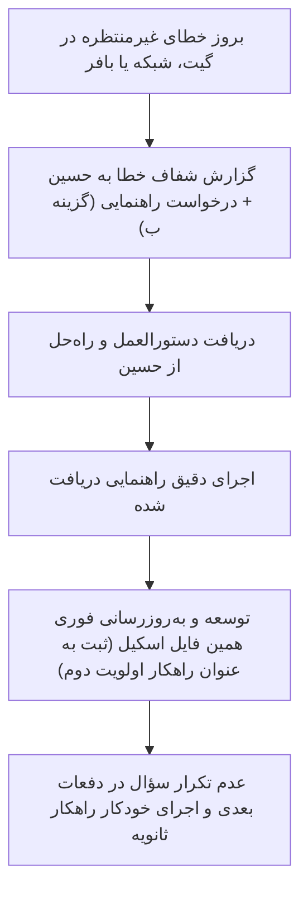

# MachineDesign Social Media Production & Scheduling Master Workflow

این اسکیل، مرجع جامع، همه‌جانبه و یکپارچه برای تمام مراحل چرخه تولید محتوا، کپی‌رایتینگ، طراحی گرافیک، میزبانی دارایی‌ها و زمان‌بندی هوشمند با Buffer برای برند **MachineDesign.ir** و کانال‌های وابسته است.

این نسخه تجمیعی، نکات حیاتی اسکیل‌های تخصصی (`hook-writer`, `caption-writer`, `carousel-writer`, `hashtag-strategy`, `instagram-growth`, `graphic-design-aesthetics`) را مستقیماً در خود ادغام کرده تا نیازی به فراخوانی چند اسکیل همزمان نباشد.

---

## ۱. استراتژی هشتگ ۲۰۲۶ و محدودیت سخت‌گیرانه (Hashtag Protocol)

### ۱.۱. قانون سقف ۵ هشتگ (Hard Cap: Maximum 3 to 5 Hashtags)
* **خط قرمز اینستاگرام:** تعداد هشتگ‌ها در هر پست **هرگز نباید از ۵ عدد بیشتر شود**. ارسال بیش از ۵ هشتگ علاوه بر ریسک بلاک یا عدم انتشار توسط API اینستاگرام، سیگنال اسپم به الگوریتم ارسال کرده و ریچ پست را سرکوب می‌کند.
* **ترکیب بهینه ۳ تا ۵ هشتگی برای ماشین دیزاین:**
  1. **۱ تگ برندینگ اختصاصی:** `#ماشین_دیزاین` یا `#machinedesign`
  2. **۲ تگ دسته‌بندی نیش و صنعتی:** `#ماشین_آلات_صنعتی` یا `#خط_تولید`
  3. **۱ تا ۲ تگ اختصاصی محصول/موضوع:** `#پیراشکی`، `#سمبوسه`، یا `#صنایع_غذایی`

### ۱.۲. سئو محتوایی به جای انباشت هشتگ (Social SEO)
* در الگوریتم مدرن، متن درون تصویر، ۳ ثانیه اول ویدیو، و کلمات کلیدی متن کپشن ۱۰ برابر بیشتر از هشتگ‌ها در سرچ و اکسپلور ایندکس می‌شوند.

---

## ۲. اصول طراحی بصری و مهندسی کاروسل‌ها (Visual & Carousel Architecture)

### ۲.۱. ممنوعیت مطلق تصاویر متراکم متنی
* هرگز اطلاعات سنگین، جداول مقایسه‌ای یا راهنماهای متنی طولانی در یک تک‌پست فشرده نمی‌شوند.
* هرگونه محتوای تحلیلی، مقایسه‌ای یا آموزشی باید حتماً در قالب **کاروسل چنداسلایدی (نسبت ۴:۵ یا ۱۰۸۰×۱۳۵۰)** طراحی شود.

### ۲.۲. آناتومی اسلاید اول (The Cover Hook Slide - برگرفته از hook-writer & carousel-writer)
* **یک وعده واضح و صریح (Promise the Swipe):** اسلاید اول باید دلیلی به کاربر بدهد که انگشتش را برای ورق زدن حرکت دهد.
* **تصویر قهرمان (Hero Machine):** عکس بزرگ، باکیفیت و ترجیحاً کراپ دقیق دستگاه در مرکز یا پایین کادر (ارتفاع حداقل ۵۰٪ تا ۵۵٪ کل بوم).
* **هدر سازمانی:** لوگوی رسمی متالیک MachineDesign.ir + عنوان انگلیسی و فارسی برند + بج اختصاصی مدل دستگاه در گوشه راست (مانند `MODEL: KBDM-150` یا `SLIDE 1/4`).
* **تیتر قلاب (Headline):** فونت بزرگ و بولد **وزیرمتن سیاه (Vazirmatn Black)** با رنگ سرمه‌ای سازمانی (`#0f1c30`) و سطر دوم با رنگ آبی/تیل صنعتی (`#104e5c`).
* **کپسول ورق زدن داینامیک:** دکمه بیضی شکیل با پس‌زمینه تیره و متن سفید (`ورق بزنید ◀`) با مارجین داینامیک (`pw = text_width + 90`).

### ۲.۳. دیسیپلین اسلایدهای میانی (One Idea Per Slide)
* هر اسلاید فقط روی **یک ایده/بخش مشخص** تمرکز دارد.
* حداکثر ۳ یا ۴ کارت خلوت با خط تأکید رنگی، بولت‌پوینت‌های متقارن و پس‌زمینه لایت (`#f8fafc`).
* **پرهیز از شکست نامناسب کلمات:** هرگز متن‌ها بر اساس تعداد کاراکتر هاردکد کات نمی‌شوند؛ خطوط با جمله‌بندی مشخص و معنایی طراحی می‌شوند.

### ۲.۴. اسلاید پایانی و کال‌تواکشن (Conversion & Save CTA)
* اسلاید آخر محل تبدیل است؛ نه تکرار حرف‌های قبل.
* جدول خلاصه یا نتیجه کلیدی (باکس طلایی برای بازگشت سرمایه یا باکس آبی برای پیش‌فاکتور).
* **فراخوان اقدام تک‌کلمه‌ای (Keyword DM Trigger):** مانند «جهت دریافت کاتالوگ و بیزینس‌پلن، کلمه سود/کارگاه را در دایرکت بفرستید».

---

## ۳. فرمول کپی‌رایتینگ و کپشن‌نویسی (Caption & Copywriting Formula - برگرفته از caption-writer)

هر کپشن برای پیج بیزینسی و شخصی ماشین دیزاین بر اساس فرمول ۴ مرحله‌ای زیر نگاشته می‌شود:
1. **خط اول (قلاب اسکرول - The Scroll-Stopper):**
   - کوتاه، چالش‌برانگیز یا برانگیزاننده کنجکاوی صنعتی (مانند: *چرا این دستگاه ظرف کمتر از ۹۰ روز پول خودش را برمی‌گرداند؟* یا *فکر می‌کنید این دستگاه فقط برای دامپلینگ چینی است؟!*).
2. **ارزش فنی و اعداد ملموس (The Meat & Proof):**
   - بدون کلی‌گویی و با اعداد دقیق مهندسی: ظرفیت ۱۰,۰۰۰ عدد در ساعت، استیل ۳۰۴، توان ۱.۸ کیلووات، ۱ سال گارانتی.
3. **فراخوان به اقدام صریح (Single Clear CTA):**
   - فقط یک درخواست مشخص: پیام در دایرکت برای استعلام قیمت یا ارسال کاتالوگ.
4. **بخش پایانی:** حداکثر ۳ تا ۵ هشتگ هدفمند در انتهای کپشن.

---

## ۴. پایپ‌لاین آپلود و CDN گیت‌هاب (Asset Hosting Pipeline)

سرویس Buffer تصاویر را دانلود می‌کند؛ بنابراین لینک‌ها باید کاملاً مستقیم (`raw.githubusercontent.com`) باشند.

### ۴.۱. مخزن رسمی دارایی‌ها:
* **مخزن:** `https://github.com/GreatFooliao111/machinedesign-social-assets`
* **شاخه اصلی:** `main`
* **مسیر دارایی‌ها:**
  - کمپین‌ها: `campaigns/<campaign_name>/02_generated_visuals/`
  - تمپلیت‌ها: `templates/`
  - لوگوها: `branding/logos/`

### ۴.۲. فرآیند آپلود خودکار:
1. ذخیره فایل‌ها در پوشه لوکال مخزن (`D:\Machinedesign.ir\machinedesign-social-assets`).
2. اجرای فرآیند کامیت و پوش گیت:
   ```bash
   git add .
   git commit -m "Add new social assets"
   git push origin main
   ```
3. تولید URL خام برای Buffer:
   ```text
   https://raw.githubusercontent.com/GreatFooliao111/machinedesign-social-assets/main/campaigns/.../filename.jpg
   ```

---

## ۵. پروتکل زمان‌بندی در Buffer MCP (Scheduling Standards)

### ۵.۱. ساعات طلایی انتشار و رفتار مخاطب صنعتی (Peak B2B Posting Hours):
* **تحلیل رفتار مخاطبان صنعتی، فنی و کارگاهی:**
  مدیران تولید، کارفرمایان کارگاه‌ها و مهندسان در طول روز کاری (۸ صبح تا ۵ بعدازظهر) درگیر عملیات کارگاهی و خط تولید هستند. ارسال پست در ساعات صبح یا اواسط روز، منجر به سوختن تعامل اولیه (Initial Engagement) می‌شود.
* **پنجره‌های طلایی انتشار در ایران (Tehran Time +03:30):**
  1. **شنبه تا چهارشنبه (روزهای اصلی کاری):**
     - **پیک اولویت اول (عصر و شب طلایی):** ساعت **۱۹:۳۰ الی ۲۰:۰۰** (زمان استراحت، بازگشت به خانه و اوج گشت‌وگذار در اینستاگرام).
     - **پست‌های تحلیلی و کاروسل‌ها (نیازمند تمرکز و ورق زدن):** ساعت **۲۰:۰۰**.
     - **پست‌های تک‌تصویر و بلوپرینت:** ساعت **۱۹:۳۰**.
  2. **پنج‌شنبه (نیمه‌تعطیل صنعتی):**
     - ساعت **۱۸:۰۰ الی ۱۸:۳۰** عصر (پیش از شروع برنامه‌ها و مهمانی‌های شب جمعه).
  3. **خط قرمز ساعات ارسال:**
     - پرهیز مطلق از زمان‌بندی در ساعات میانی صبح (۱۰ تا ۱۲ صبح) یا ساعات بسیار دیر شب (بعد از ۲۲:۰۰).

### ۵.۲. متد ارسال:
* از متد `create_post` یا `edit_post` با پارامترهای زیر استفاده شود:
  - `mode: "customScheduled"` (الزامی جهت اعمال فیلد `dueAt`)
  - `schedulingType: "automatic"`
  - `dueAt`: تاریخ دقیق به همراه آفست زمانی تهران (`YYYY-MM-DDTHH:mm:ss+03:30`)
  - `metadata: { instagram: { type: "post", shouldShareToFeed: true } }`
  - برای کاروسل‌ها، تمام اسلایدها در آرایه `assets` قرار گیرند.

### ۵.۳. پروتکل تگ و مشارکت با اکانت شخصی (@h.vatan.doust):
* **تگ خودکار کاربری در API بافر (`userTags`):**
  در تمام پست‌ها، پوسترها و اسلاید اول کاروسل‌های پیج بیزینسی (`@machinedesign.ir`)، شناسه اکانت شخصی حسین باید به صورت خودکار در متادیتای تصویر تگ شود:
  ```json
  "userTags": [
    { "handle": "h.vatan.doust", "x": 0.5, "y": 0.5 }
  ]
  ```
  با این تنظیم، پست به صورت خودکار در تب **Tagged Photos** پیج شخصی قرار می‌گیرد و با لمس تصویر نام پیج شخصی ظاهر می‌شود.
* **پست مشترک (Instagram Collab / Co-author):**
  پست‌های مشارکتی (نمایش مشترک هر دو پیج در بالای پست و ظاهر شدن در گرید فید اصلی هر دو اکانت) در محیط وب Buffer (بخش Composer دکمه Invite Collaborators) پشتیبانی می‌شود. در سطح API بافر، فیلد `userTags` ابزار رسمی برای ثبت مشارکت است.

---

## ۶. چرخه یادگیری و خودبه‌بودی هوشمند (Self-Improving Error Handling)

طبق دستور صریح حسین:



### لاگ راهکارهای ثانویه ثبت‌شده (Fallback Registry):
* **قانون ۱ (سقف هشتگ):** الزام قطعی محدودیت ۳ تا ۵ هشتگ در تمامی پست‌های اینستاگرام.
* **قانون ۲ (هاست تصاویر بافر):** استفاده از مخزن عمومی GitHub و استخراج لینک مستقیم `raw.githubusercontent.com`.
* **قانون ۳ (طول دکمه ورق بزنید):** محاسبه داینامیک عرض کپسول با فرمول `pw = bbox + 90`.
* **قانون ۴ (مشارکت و تگ اکانت شخصی):** الزام درج خودکار `userTags` با هندل `h.vatan.doust` در اسلاید اصلی تمامی پست‌های پیج ماشین دیزاین.
* **قانون ۵ (ساعات طلایی انتشار):** الزام زمان‌بندی پست‌ها در ساعات اوج تعامل مخاطبان صنعتی (۱۹:۳۰ الی ۲۰:۰۰ برای روزهای کاری و ۱۸:۰۰ الی ۱۸:۳۰ برای پنج‌شنبه‌ها) و پرهیز از ساعات صبحگاهی یا بعد از ۲۲:۰۰.
